# Clasificación de fallas en una línea de transmisión

## Datos de la actividad

- **Estudiante:** Miguel Ángel Mango Valga
- **Carrera:** Ingeniería Eléctrica, INACAP
- **Año:** 2026
- **Docente:** Boris Esteban Cáceres Torres
- **Actividad:** Actividad formativa GitHub Copilot (Tendencias de IA)

## Objetivo

El objetivo de esta actividad es usar GitHub Copilot como apoyo para crear un programa en Python que lea mediciones eléctricas, las use para entrenar un clasificador KNN y estime el tipo de falla de una línea de transmisión. También se explora cómo una predicción puede convertirse en una recomendación inicial para un técnico.

El programa es un ejercicio académico. Sus predicciones y recomendaciones no reemplazan el análisis de protecciones, los procedimientos de seguridad ni el criterio de personal autorizado.

## Dataset

Se utilizó el conjunto de datos de Kaggle [Electrical Fault detection and classification](https://www.kaggle.com/datasets/esathyaprakash/electrical-fault-detection-and-classification), descargado como [`classData.csv`](classData.csv). El archivo contiene **7.861 registros** con las columnas `G`, `C`, `B`, `A` y las mediciones de corriente y tensión `Ia`, `Ib`, `Ic`, `Va`, `Vb` y `Vc`.

Las columnas `G`, `C`, `B` y `A` indican si tierra y las fases participan en la falla. En el orden `G-C-B-A`, se forman códigos como `1001` o `0110`, que el programa convierte en nombres de falla.

Al revisar el archivo encontré una diferencia importante: la documentación describe `0011` como falla entre las fases A y B, pero esa combinación **no aparece** en los datos descargados. En cambio, el CSV sí contiene `0110`, que en el orden `G-C-B-A` corresponde a las fases B y C. El programa reconoce ambos códigos, pero en este archivo `0011` tiene cero registros y `0110` tiene 1.004. Por eso se mantuvo la distinción al crear las etiquetas.

### Registros por combinación

| Código `G-C-B-A` | Etiqueta | Registros |
|---|---|---:|
| `0000` | Sin falla | 2.365 |
| `1001` | LG: fase A a tierra | 1.129 |
| `0011` | LL: fases A-B (documentado, no observado en el CSV) | 0 |
| `0110` | LL: fases B-C | 1.004 |
| `1011` | LLG: fases A-B a tierra | 1.134 |
| `0111` | LLL: trifásica | 1.096 |
| `1111` | LLLG: trifásica a tierra | 1.133 |
| **Total** |  | **7.861** |

## Proceso con Copilot Chat

Estas capturas muestran el desarrollo en orden:

1. **Crear el repositorio:** preparación del espacio de trabajo en GitHub.<br>
   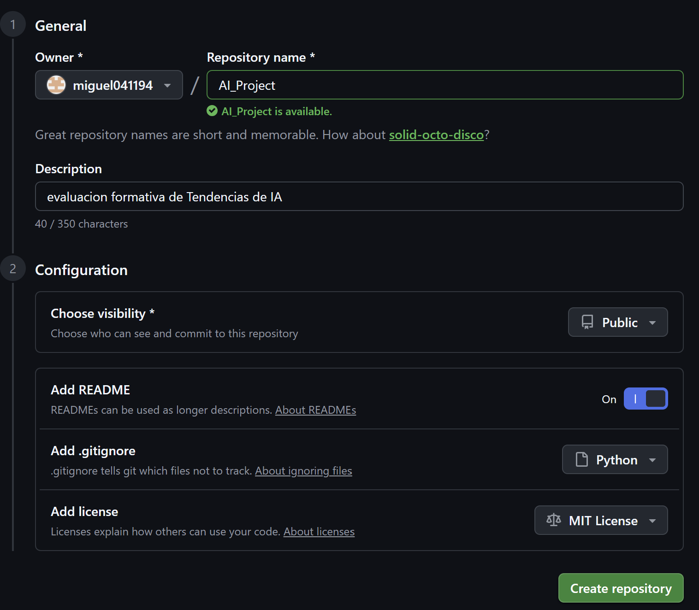
2. **Descargar el dataset:** búsqueda y descarga de los datos desde Kaggle.<br>
   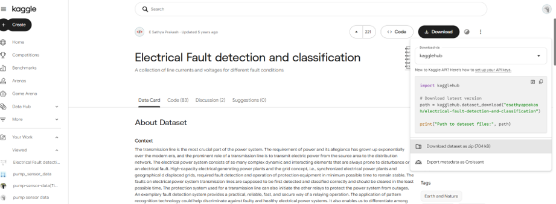
3. **Revisar las columnas:** consulta de la estructura y significado de los datos en Kaggle.<br>
   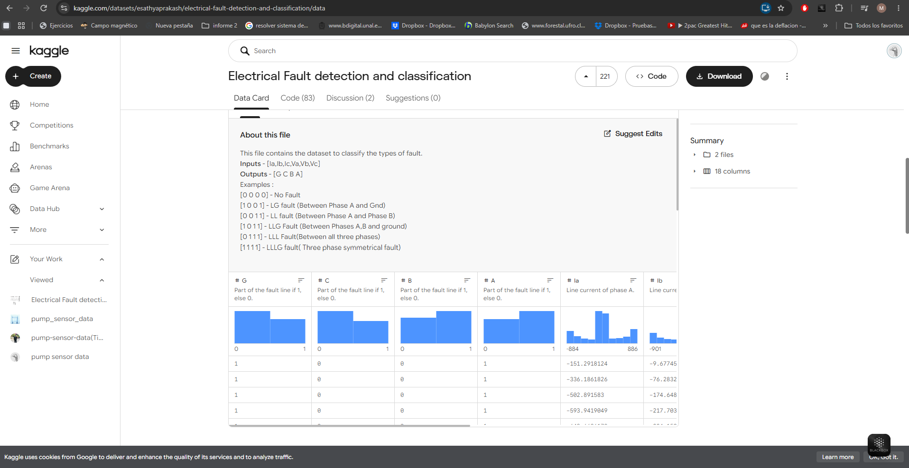
4. **Subir el archivo:** acceso a la opción para agregar el CSV al repositorio.<br>
   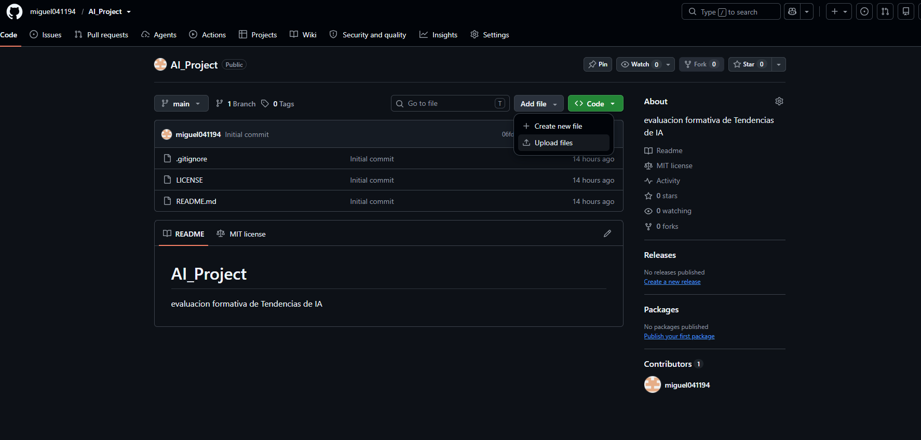
5. **Confirmar la subida:** guardar los cambios del archivo en GitHub.<br>
   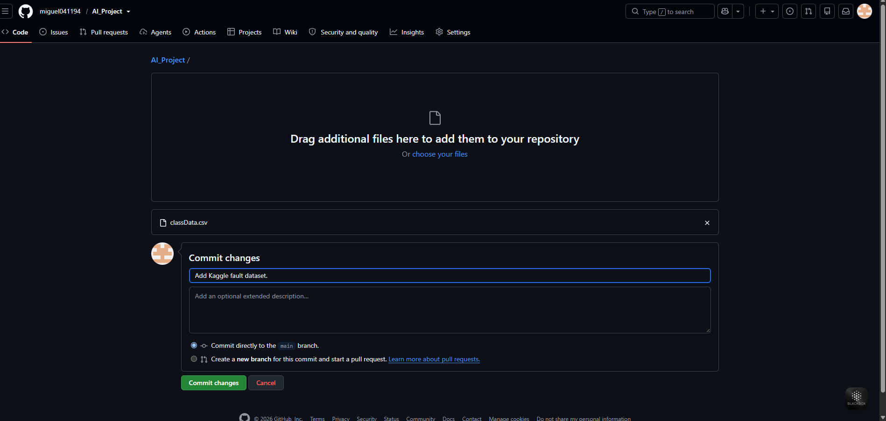
6. **Comprobar el dataset:** verificar que el CSV quedó en el repositorio.<br>
   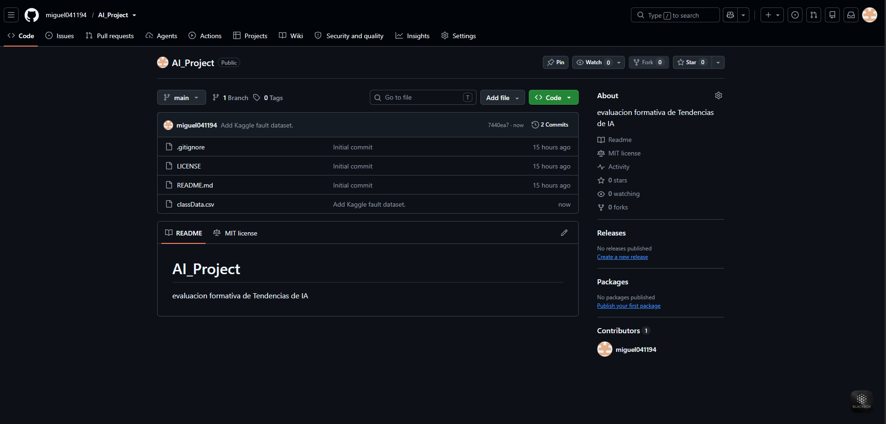
7. **Abrir Codespaces:** iniciar el entorno de desarrollo desde GitHub.<br>
   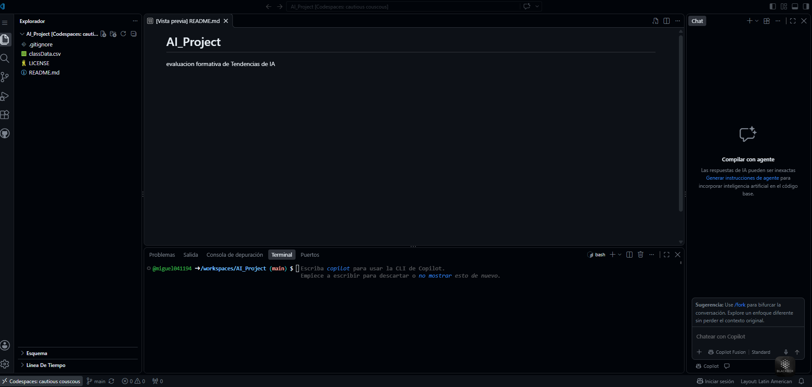
8. **Usar Copilot:** revisar el acceso a Copilot para apoyar el trabajo.<br>
   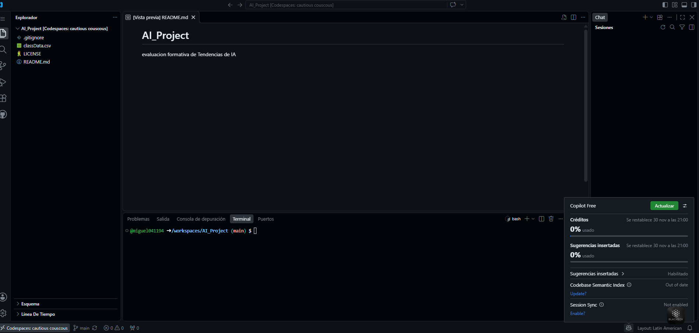
9. **Preparar dependencias:** pedir orientación para el archivo `requirements.txt`.<br>
   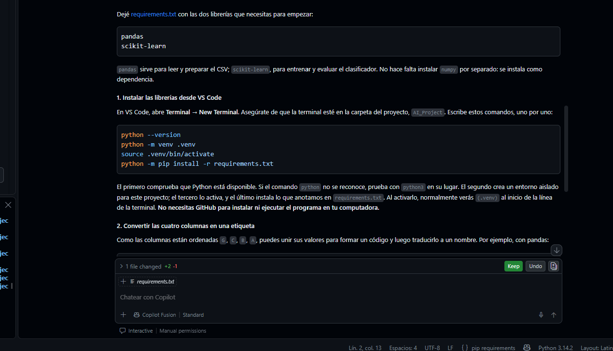
10. **Crear etiquetas:** pedir ayuda para asociar combinaciones de bits con nombres de fallas, incluyendo `0110`.<br>
    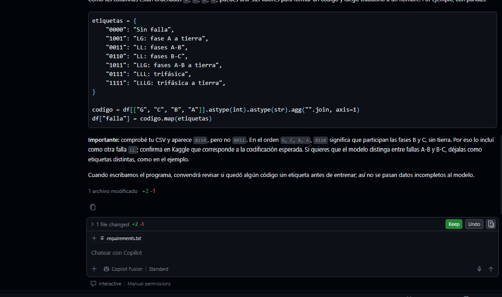
11. **Instalar librerías:** configurar el entorno e instalar las dependencias del proyecto.<br>
    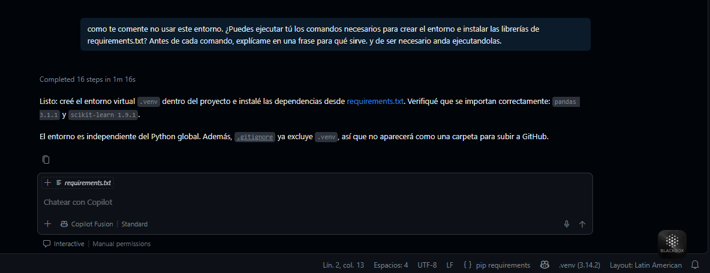
12. **Contar las fallas:** ejecutar el primer programa para revisar los registros etiquetados.<br>
    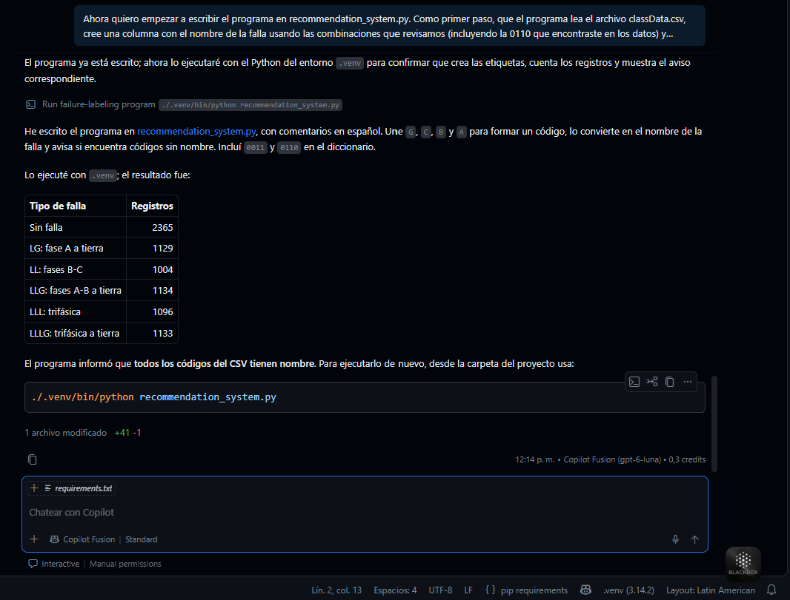
13. **Entrenar KNN:** agregar la separación de datos, el escalado y la evaluación del clasificador.<br>
    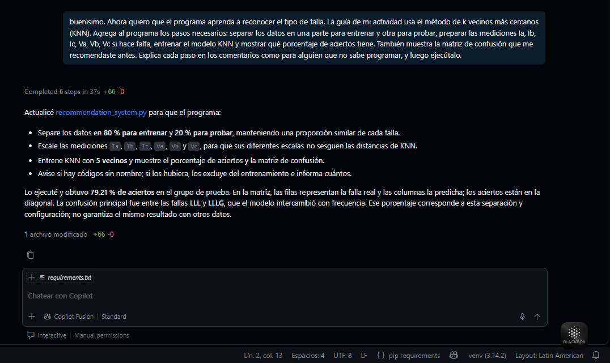
14. **Analizar fallas trifásicas:** estudiar la confusión entre LLL y LLLG y probar su agrupación.<br>
    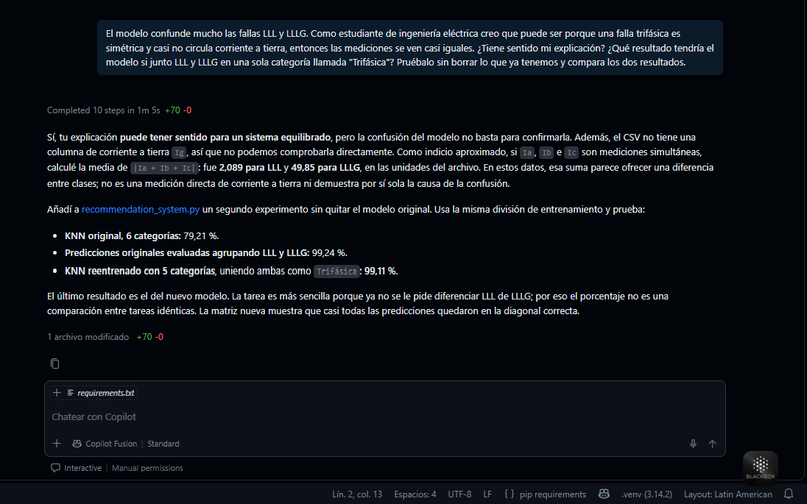
15. **Agregar corriente residual:** probar `Ir = Ia + Ib + Ic` como una entrada adicional.<br>
    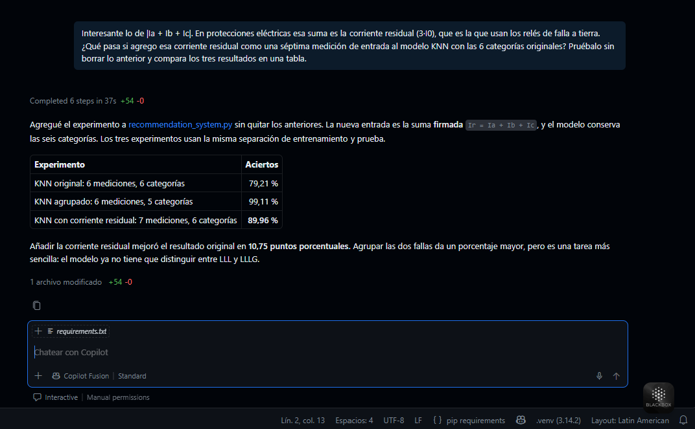
16. **Guardar el avance:** crear un commit y subir los cambios a GitHub.<br>
    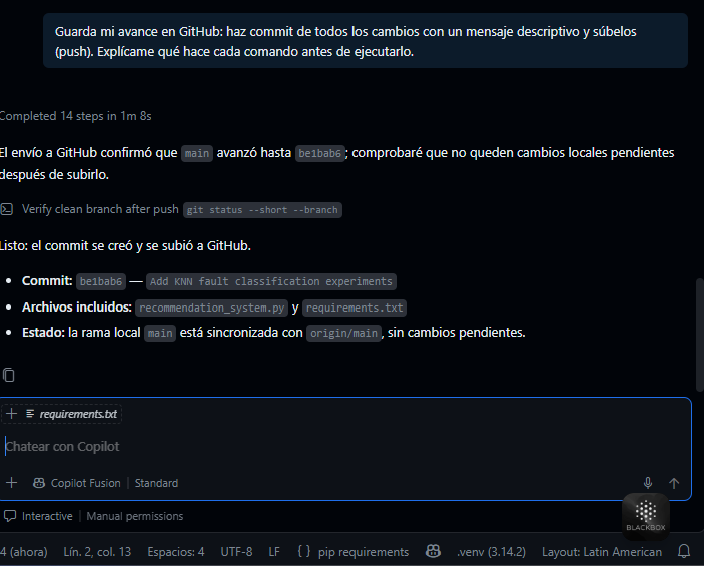
17. **Probar una recomendación:** generar una predicción y una acción para una medición.<br>
    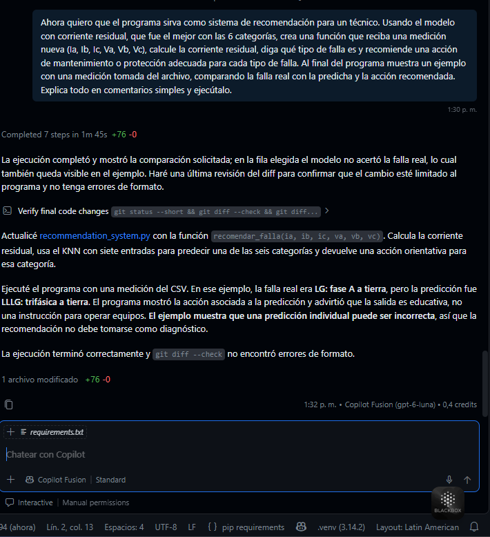
18. **Revisar varios ejemplos:** mostrar una medición de prueba por cada clase, acierto, votos y acción.<br>
    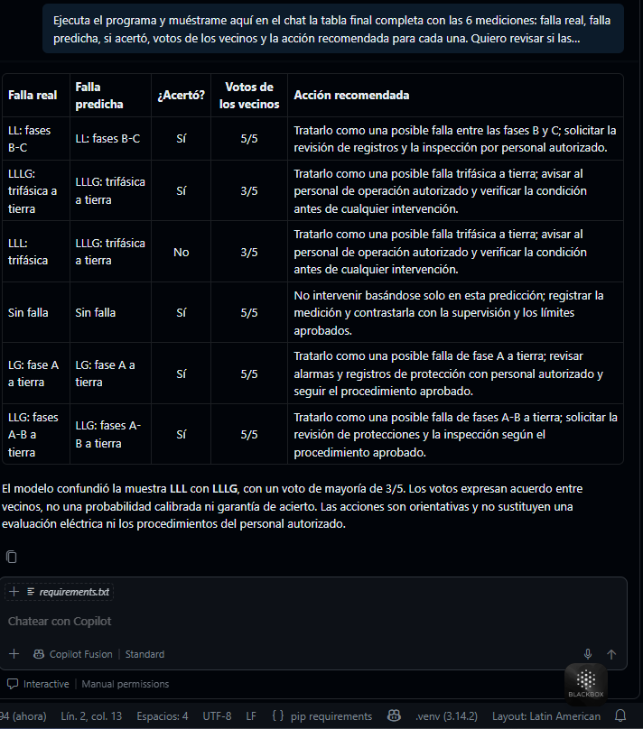
19. **Afinar las acciones:** hacer las recomendaciones más específicas y añadir una advertencia cuando hay pocos votos.<br>
    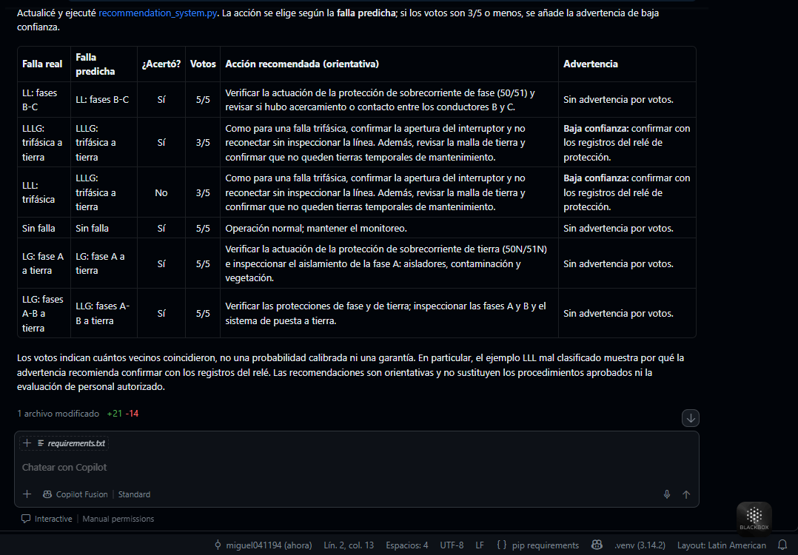

## Proceso del programa

El archivo [`recommendation_system.py`](recommendation_system.py) realiza estos pasos:

1. Lee `classData.csv` y forma una etiqueta uniendo los valores `G`, `C`, `B` y `A`.
2. Informa cuántos registros hay por falla y avisa si encuentra códigos desconocidos.
3. Usa las seis señales `Ia`, `Ib`, `Ic`, `Va`, `Vb` y `Vc` como entradas.
4. Divide los registros en 80 % para entrenamiento y 20 % para prueba, manteniendo proporciones similares de clases.
5. Escala las mediciones y entrena un KNN con cinco vecinos.
6. Muestra el porcentaje de aciertos y la matriz de confusión.
7. Compara el modelo original con dos pruebas: unir LLL y LLLG en una categoría, y añadir la corriente residual como séptima entrada.
8. Entrena el modelo con corriente residual, que se usa en la función `recomendar_falla`, y presenta ejemplos del conjunto de prueba.

## Resultados

El conteo del CSV fue:

| Tipo de falla | Registros |
|---|---:|
| Sin falla | 2.365 |
| LG: fase A a tierra | 1.129 |
| LL: fases B-C | 1.004 |
| LLG: fases A-B a tierra | 1.134 |
| LLL: trifásica | 1.096 |
| LLLG: trifásica a tierra | 1.133 |
| **Total** | **7.861** |

Con una división estratificada de 80/20 y cinco vecinos, los resultados de esta ejecución fueron:

| Experimento | Categorías | Entradas | Aciertos |
|---|---:|---:|---:|
| KNN original | 6 | 6 mediciones | 79,21 % |
| KNN reentrenado agrupando LLL y LLLG como “Trifásica” | 5 | 6 mediciones | 99,11 % |
| KNN con corriente residual `Ir = Ia + Ib + Ic` | 6 | 7 mediciones | 89,96 % |

La principal confusión del modelo original fue entre LLL y LLLG. De las muestras LLL de prueba, 160 fueron clasificadas como LLLG; y de las muestras LLLG, 155 fueron clasificadas como LLL. El resultado de 99,11 % corresponde a un problema más sencillo porque las dos clases trifásicas se juntaron. Añadir la corriente residual mejoró el resultado de seis clases en esta prueba, pero no eliminó la confusión entre las fallas trifásicas.

### Acciones orientativas del programa

La acción se elige según la falla **predicha**. Si 3 o menos de los cinco vecinos votan por ella, el programa agrega: **“Baja confianza: confirmar con los registros del relé de protección.”**

| Falla predicha | Acción orientativa |
|---|---|
| Sin falla | Operación normal; mantener el monitoreo. |
| LG: fase A a tierra | Verificar la actuación de la protección de sobrecorriente de tierra (50N/51N) e inspeccionar el aislamiento de la fase A: aisladores, contaminación y vegetación. |
| LL: fases B-C | Verificar la actuación de la protección de sobrecorriente de fase (50/51) y revisar si hubo acercamiento o contacto entre los conductores B y C. |
| LLG: fases A-B a tierra | Verificar las protecciones de fase y de tierra; inspeccionar las fases A y B y el sistema de puesta a tierra. |
| LLL: trifásica | Considerarla una falla potencialmente asociada a una corriente de cortocircuito elevada; confirmar la apertura del interruptor y no reconectar sin inspeccionar la línea. |
| LLLG: trifásica a tierra | Como para una falla trifásica, confirmar la apertura del interruptor y no reconectar sin inspeccionar la línea. Además, revisar la malla de tierra y confirmar que no queden tierras temporales de mantenimiento. |

Los votos indican cuántos vecinos coincidieron; **no son una probabilidad calibrada ni garantizan que la predicción sea correcta**. La salida es educativa y no debe usarse por sí sola para operar equipos eléctricos. Las decisiones reales requieren personal autorizado y los procedimientos aprobados de la instalación.

## Cómo ejecutar

Se necesita Python instalado. Desde una terminal abierta en la carpeta del proyecto, ejecutar:

```bash
python -m venv .venv
source .venv/bin/activate
python -m pip install -r requirements.txt
python recommendation_system.py
```

En Windows, la activación del entorno se hace con:

```powershell
.\.venv\Scripts\Activate.ps1
```

El archivo `requirements.txt` instala `pandas` y `scikit-learn`. El CSV debe permanecer en la raíz del proyecto junto al programa.

## Reflexión

Copilot me ayudó a pasar de una idea general a un programa que lee los datos, crea las etiquetas, entrena KNN y presenta resultados. También me sirvió para entender paso a paso el entorno de Python, GitHub y conceptos como la matriz de confusión. Fui construyendo el trabajo con instrucciones concretas y ejecutando el programa para revisar cada resultado.

De todas formas, tuve que comprobar las respuestas con mi propio criterio. Revisé en Kaggle el significado de `G`, `C`, `B` y `A`, y detecté que la combinación documentada `0011` no estaba en el CSV, mientras que aparecía `0110`. También revisé la confusión entre LLL y LLLG, propuse probar la corriente residual desde protecciones eléctricas y verifiqué que las recomendaciones nombraran las protecciones y revisiones pertinentes. Finalmente, consideré que una etiqueta predicha y los votos de cinco vecinos no son un diagnóstico ni una autorización para intervenir una línea.

## Referencias

GitHub. (s. f.). *About GitHub Copilot*. GitHub Docs. https://docs.github.com/en/copilot/get-started/about-github-copilot

E. Sathya Prakash. (2021). *Electrical Fault detection and classification* (versión 2) [Conjunto de datos]. Kaggle. https://www.kaggle.com/datasets/esathyaprakash/electrical-fault-detection-and-classification

scikit-learn developers. (s. f.). *KNeighborsClassifier*. scikit-learn. https://scikit-learn.org/stable/modules/generated/sklearn.neighbors.KNeighborsClassifier.html
